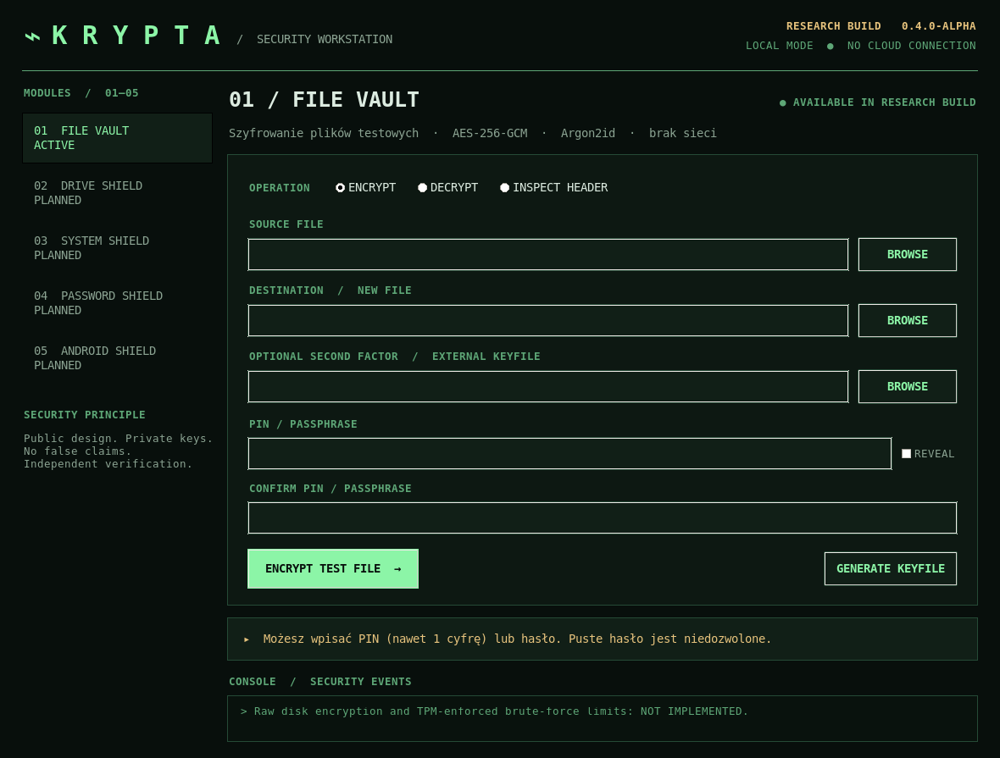

# KRYPTA

**Protokół kontynuacji prac i odbioru PR:** [AGENTS.md](AGENTS.md). Priorytetem pozostaje bezpieczne szyfrowanie fizycznych nośników; każdy etap wymaga rzeczywistego kodu i zielonych testów.

**System szyfrowania plików i rozwijany własny silnik zaszyfrowanych woluminów.** Windows · Linux · Android.

KRYPTA działa niezależnie, bez obowiązkowego konta. Aplikacje na Windows, Linux i Android umożliwiają lokalne szyfrowanie oraz odszyfrowywanie **wskazanych plików**. Rozwój obejmuje także własne zaszyfrowane woluminy, system plików, odzyskiwanie oraz zabezpieczanie kluczy.

**[Co naprawdę działa, a co pozostaje do ukończenia — aktualna tabela funkcji](docs/FUNCTION_STATUS.md)**. Główny cel pozostaje bez zmian: transparentne szyfrowanie woluminów, nośników i docelowo urządzeń. Obecne pliki do pobrania są wydaniami rozwojowymi, nie sprawdzonymi narzędziami do ochrony jedynych kopii cennych danych.

## 📥 Pobierz aplikację

**[ZOBACZ WSZYSTKIE PLIKI DO POBRANIA — GitHub Releases](https://github.com/promirmir/KRYPTA/releases)**

**Bezpośrednie pliki ze sprawdzonego wydania rozwojowego [krypta-dev-34-1](https://github.com/promirmir/KRYPTA/releases/tag/krypta-dev-34-1) (22.10.2026):**

| System | Plik do pobrania | Główna funkcja |
|---|---|---|
| 🪟 **Windows 10/11 x64** | **[KRYPTA-Windows-x64.exe](https://github.com/promirmir/KRYPTA/releases/download/krypta-dev-34-1/KRYPTA-Windows-x64.exe)** | Graficzny File Vault oraz Volume Lab (testowe zaszyfrowane obrazy) |
| 🐧 **Linux x64** | **[KRYPTA-Linux-x64](https://github.com/promirmir/KRYPTA/releases/download/krypta-dev-34-1/KRYPTA-Linux-x64)** | Graficzny File Vault i Volume Lab; oddzielne narzędzie Linux FUSE |
| 🤖 **Android** | **[KRYPTA-Android-debug.apk](https://github.com/promirmir/KRYPTA/releases/download/krypta-dev-34-1/KRYPTA-Android-debug.apk)** | Szyfrowanie wybranych dokumentów z kluczem chronionym przez Android Keystore |

**Osobne narzędzia ratunkowe (bez GUI):**

| System | Program odzyskiwania |
|---|---|
| Windows x64 | [KRYPTA-Windows-x64-Rescue.exe](https://github.com/promirmir/KRYPTA/releases/download/krypta-dev-34-1/KRYPTA-Windows-x64-Rescue.exe) |
| Linux x64 | [KRYPTA-Linux-x64-Rescue](https://github.com/promirmir/KRYPTA/releases/download/krypta-dev-34-1/KRYPTA-Linux-x64-Rescue) |

Programy wymagają pasującego pliku `.pvkey`, oddzielnego 32-bajtowego klucza odzyskiwania oraz niezależnie przechowanego aktualnego `receipt`. Po uwierzytelnieniu całego obrazu PFS/2 tworzą **nowy folder z odszyfrowanymi, JAWNYMI plikami**. Źródłowy obraz pozostaje bez zmian. Nie jest to odzyskiwanie pełnego dysku ani niezależnie audytowane rozwiązanie produkcyjne. [Instrukcja](docs/OFFLINE_RESCUE_ALL.md).

Powyższe linki pobierają bezpośrednio pliki z wydania rozwojowego **dev-34-1**, odpowiadającego scalonemu [PR #56](https://github.com/promirmir/KRYPTA/pull/56). Najnowsze wersje, w tym kolejne funkcje Volume Lab, znajdziesz na [stronie wszystkich wydań](https://github.com/promirmir/KRYPTA/releases). Załączone pliki z rozszerzeniem .sha256 pozwalają sprawdzić integralność pobranych plików. **Repozytorium jest publiczne.** Każdy może czytać kod i pobrać udostępnione wydania rozwojowe. Kod otwarty nie oznacza zakończonego audytu ani gotowości produktu.

**Status: kompilacje rozwojowe, a nie certyfikowane wydania produkcyjne.** Korzystaj wyłącznie z kopii danych testowych. Aplikacje nie szyfrują jeszcze całego dysku systemowego ani całego telefonu.

## Zewnętrzny pin zaufanego stanu obrazu (Volume Lab)

W aktualizowanym Volume Lab istnieją osobne działania **Utwórz pin .kpin** oraz **Sprawdź pin (R/O)**: pierwsze wymaga wcześniej niezależnie znanego `receipt`, zapisuje nowy plik `.kpin` bez nadpisywania i wyświetla SHA-256 jego pieczęci. Drugie wymaga ponownego dostarczenia **wcześniej niezależnie zapamiętanej** pieczęci i wykonuje pełną weryfikację tylko do odczytu. Żaden wynik nie zatwierdza automatycznie nowszej wersji obrazu ani nie zastępuje zaufania zapewnionego osobnym nośnikiem. **Funkcje te pojawią się w wydaniu z PR integrującym GUI; `dev-34-1` zawiera jedynie API i testy silnika.** [Zasady i ograniczenia](docs/RECEIPT_PIN_TRUST.md).

## Aktualny postęp Windows WinFsp — 22.10.2026

**Potwierdzone na rzeczywistym sterowniku WinFsp w Windows CI:** montowanie i odmontowanie tymczasowego zaszyfrowanego obrazu `.kpv` ([PR #39](https://github.com/promirmir/KRYPTA/pull/39)); otwarcie i odczyt pliku poprzez natywną ścieżkę Windows przy ograniczonym do konta testowego i SYSTEM deskryptorze tylko do odczytu ([PR #40](https://github.com/promirmir/KRYPTA/pull/40)); odrzucenie przez Windows prób nadpisania, utworzenia, usunięcia oraz zmiany nazwy pliku, z zachowaniem oryginalnych danych ([PR #41](https://github.com/promirmir/KRYPTA/pull/41)). [Zielony przebieg testów PR #41](https://github.com/promirmir/KRYPTA/actions/runs/39693827341).

**Potwierdzony kolejny etap:** [PR #42](https://github.com/promirmir/KRYPTA/pull/42) został scalony po przejściu wszystkich testów i analizy bezpieczeństwa. Rzeczywisty WinFsp w Windows potwierdził wyświetlanie katalogu dwóch plików, odczyt obu, odmowę dostępu do brakującego pliku oraz blokowanie modyfikacji przy włączonej fladze tylko do odczytu. [Dowód: GitHub Actions #39733676912](https://github.com/promirmir/KRYPTA/actions/runs/39733676912).

**W narzędziu osobnym (nie jest to montowanie w głównym wydaniu EXE):** źródłowe, ręczne montowanie już istniejącego, uwierzytelnionego obrazu za pomocą hasła lub klucza odzyskiwania i zewnętrznego zaufanego `receipt`. [Instrukcja i ograniczenia](docs/WINDOWS_WINFSP_READONLY_MOUNT.md).

**Istotne ograniczenia:** interfejs WinFsp to wciąż prototyp **tylko do odczytu**, wykonywany na zwykłym pliku testowym `.kpv`. Nie obsługuje zapisu przez zamontowany system plików, montowania fizycznych dysków lub partycji ani transparentnego szyfrowania Windows. Nie jest to gotowa funkcja z plików wydania `krypta-dev-34-1`; wyniki dotyczą kodu źródłowego i CI. Wymagane są dalsze testy, przegląd ACL i niezależny audyt przed korzystaniem z rzeczywistych danych.

## Możliwości KRYPTA

Poniższa tabela jest skrótem. Szczegóły, potwierdzenia i braki: [stan funkcji i droga do 1.0](docs/FUNCTION_STATUS.md).

| Funkcja | Windows | Linux | Android |
|---|:---:|:---:|:---:|
| Graficzny interfejs | ✅ | ✅ | ✅ |
| Szyfrowanie i odszyfrowywanie wybranych plików | ✅ | ✅ | ✅ |
| AES-256-GCM z uwierzytelnieniem integralności | ✅ | ✅ | ✅ |
| Hasło i Argon2id | ✅ | ✅ | — |
| Android Keystore i uwierzytelnienie urządzenia | — | — | ✅ |
| Własny silnik zaszyfrowanych woluminów PVIMG/1 | W kodzie | W kodzie | — |
| **Volume Lab PFS/2 — obrazy .kpv (wydanie dev-34-1)** | ✅ test | ✅ test | — |
| Potwierdzone montowanie zaszyfrowanego katalogu przez FUSE | — | ✅ osobne narzędzie | — |
| WinFsp: natywny odczyt z testowego obrazu `.kpv` (źródła / CI, nie wydanie) | ✅ test | — | — |
| Transparentne szyfrowanie całego urządzenia | ❌ | ❌ | ❌ |
| Sprzętowy limit prób krótkiego PIN-u | ❌ | ❌ | ❌ |
| Zweryfikowane przenośne odzyskiwanie kluczy | ❌ | ❌ | ❌ |

### Windows i Linux — File Vault

Szyfrowanie wybranych plików do formatu KRYPTA przy użyciu AES-256-GCM, losowego klucza danych, Argon2id i opcjonalnego pliku klucza. Dane pozostają lokalne; hasło nie jest przekazywane przez argumenty CLI. Przy pomocy graficznej aplikacji można wybrać plik i wykonać szyfrowanie lub odszyfrowanie.

### Android — File Vault

KRYPTA-MOBILE/1 pozwala zaszyfrować i odszyfrować wybrany dokument z użyciem AES-256-GCM i urządzeniowego Android Keystore. Aplikacja nie ma uprawnień do zastąpienia szyfrowania całej pamięci telefonu. **Android i desktop mają obecnie różne formaty plików.**

### Encrypted Volume Engine — Linux i Windows

KRYPTA-PVIMG/1 ma własny uwierzytelniony wielopoziomowy indeks, szyfrowanie sektorów i transakcje copy-on-write. W Linux pomyślnie zweryfikowano **rzeczywiste montowanie FUSE** i operacje na pliku 610 KiB. Obecny zaszyfrowany katalog PFS/1 jest płaski i obsługuje do 128 plików, każdy do 960 KiB. **1 GiB logicznej przestrzeni adresowej silnika nie jest gwarancją 1 GiB użytecznej pojemności.**

[Stan funkcji i bezpieczeństwa](docs/SECURITY_STATUS.md) · [Linux FUSE — dowody](docs/PVIMG_LINUX_FUSE.md) · [Plan ukończenia wersji 1.0](docs/PRODUCT_ACCEPTANCE.md)

## Instalowanie i bezpieczeństwo pobierania

**Windows:** pobierz plik EXE i sprawdź jego SHA-256. EXE nie ma produkcyjnego podpisu wydawcy, więc Windows może ostrzegać. Nie obchodź ostrzeżeń systemu bez sprawdzenia pochodzenia pliku.

**Linux:** pobierz plik KRYPTA-Linux-x64. Wymaga kompatybilnego środowiska graficznego oraz bibliotek Tk. Uruchom:

~~~bash
chmod +x KRYPTA-Linux-x64
./KRYPTA-Linux-x64
~~~

**Android:** pobierz APK debug. Jego podpis **nie jest stabilnym podpisem produkcyjnym**. Nowy APK może wymagać ponownego zainstalowania, a odinstalowanie, reset Android Keystore lub utrata urządzenia mogą **nieodwracalnie uniemożliwić odszyfrowanie** danych. Nie używaj go do jedynych kopii dokumentów.

## Odblokowanie zaszyfrowanych woluminów — prace nad kluczami

Własny silnik woluminów otrzymał osobny format `KRYPTA-PVKEY/1`: długie hasło (Argon2id) i **niezależny 256-bitowy klucz odzyskiwania**. Obsługiwane jest również testowe montowanie FUSE z kluczem odblokowanym przez hasło zamiast surowego klucza. Mechanizm jest dostępny w narzędziach źródłowych; w **wydaniu dev-7-1** desktop Volume Lab (Windows/Linux) udostępnia testowe odblokowywanie obrazów hasłem lub osobnym kluczem odzyskiwania. Android APK nie obsługuje tego formatu. Krótki PIN bez prawdziwej sprzętowej kontroli prób nie daje odporności na odgadywanie. [Dokumentacja](docs/PVKEY_PASSWORD_RECOVERY.md).

## Wymiana klucza zaszyfrowanego obrazu — prace nad migracją

Rozwijany silnik może utworzyć **nowy obraz PVIMG/PFS2 z innym losowym kluczem danych**, po zweryfikowaniu i ponownym zaszyfrowaniu aktualnych plików. Nowy obraz otrzymuje również nowy klucz odzyskiwania i hasło. Operacja nie nadpisuje źródła. **Stare kopie obrazu posiadane przez inne osoby pozostają odczytywalne za pomocą starego klucza** — zmiana klucza nie cofa wcześniejszego ujawnienia danych. Funkcja jest dostępna w narzędziach źródłowych oraz w **testowym Volume Lab dla Windows/Linux (dev-7-1)**. Nie dotyczy Android APK ani dysków systemowych. [Zasady rotacji i ograniczenia](docs/PFS2_DATA_KEY_ROTATION.md).

## Volume Lab — interfejs testowych zaszyfrowanych obrazów

**Wprowadzono w dev-8-1, nadal dostępne w dev-9-1:** weryfikacja obrazu, eksport plików i weryfikacja przy migracji klucza korzystają z systemowego trybu otwierania tylko do odczytu. Nie usuwają niezatwierdzonych fragmentów logu po przerwanym zapisie. Utrzymanie `receipt` poza obrazem nadal jest obowiązkowe. [Dowody z CI](https://github.com/promirmir/KRYPTA/actions/runs/39665972976).

Powstał osobny moduł desktopowy **Volume Lab (PFS/2)** do tworzenia zaszyfrowanych zwykłych plików `.kpv`, weryfikacji autentyczności i integralności, importu/eksportu plików, odzyskiwania hasła oraz rotacji losowego klucza szyfrowania. Jest to moduł **rozwojowy**, nie szyfruje partycji ani dysków systemowych. Wymaga zewnętrznego zaufanego `receipt`, nie nadpisuje istniejących plików i nie usuwa jawnych oryginałów. [Pełna instrukcja i ograniczenia](docs/VOLUME_LAB_GUI.md).

**Aktualne wydanie:** `krypta-dev-9-1` zawiera Volume Lab w EXE Windows oraz Linux ELF. Jego testy pakowanego programu i trzyplatformowy workflow GitHub Actions zakończyły się powodzeniem. To wciąż **wersja rozwojowa**, a nie pełne szyfrowanie dysków ani niezależnie audytowany produkt. Android APK nadal używa oddzielnego File Vault.

## Awaryjne odzyskiwanie bez aplikacji graficznej

**Dev-10-1:** oprócz źródłowych poleceń `python -m research.paged_key_cli list-files` i `export-file` istnieją już oddzielne, testowane w CI programy konsolowe Windows i Linux. Mogą odzyskać **wszystkie aktualne pliki** z obrazu `.kpv` do osobnego nowego folderu bez uruchamiania GUI. Wymagane są oryginalny obraz, `.pvkey`, oddzielny klucz recovery i aktualny zaufany `receipt`. Wynik to **niezaszyfrowany plaintext** i manifest bez podpisu; awaria procesu może zostawić częściowy folder. [Procedura pełnego odzyskiwania](docs/OFFLINE_RESCUE_ALL.md) · [Polecenia odzyskiwania pojedynczych plików](docs/OFFLINE_RECOVERY_CLI.md).

Funkcja nadal **nie odzyskuje danych z całych zaszyfrowanych dysków systemowych, telefonu ani Android Keystore**, nie odtwarza utraconego klucza odzyskiwania i nie zastępuje sprawdzonej kopii zapasowej.

## Docelowe funkcje produktu

1. Pełne, automatyczne szyfrowanie woluminów Windows i Linux.
2. Obsługa dysków USB, SSD i HDD oraz bezpieczny proces odzyskiwania.
3. Sprzętowo chronione klucze i krótkie PIN-y z rzeczywistą blokadą prób odgadywania.
4. Ochrona rozruchu i dysków systemowych po weryfikacji na odizolowanym sprzęcie.
5. Bezpieczna integracja z Androidem w zakresie, na jaki pozwalają uprawnienia systemu.
6. Niezależny audyt, testy awarii i porównanie z uznanymi rozwiązaniami.

**Celem jest najwyższa mierzalna jakość zabezpieczeń.** Nie deklarujemy przewagi nad każdym innym systemem bez testów porównawczych, audytu i dowodów.

## Dokumentacja i rozwój

[Architektura](docs/ARCHITECTURE.md) · [Wymagania wersji 1.0](docs/PRODUCT_ACCEPTANCE.md) · [Instrukcja budowania](docs/BUILD_AND_RELEASE.md) · [Bezpieczeństwo](SECURITY.md) · [Testy i kompilacje](https://github.com/promirmir/KRYPTA/actions)

---

### English

**KRYPTA** is an independent encryption project for Windows, Linux and Android. **[Download the development EXE, Linux executable and Android APK from GitHub Releases](https://github.com/promirmir/KRYPTA/releases).** Selected-file encryption works on all three platforms; the authenticated encrypted-volume engine and Linux FUSE integration are under development. These versions do **not** protect full system disks/phones and do not have production key recovery, independent audit or guaranteed secure short-PIN protection. Use disposable test data only. Source code and development downloads are public. These are NOT verified production releases.
